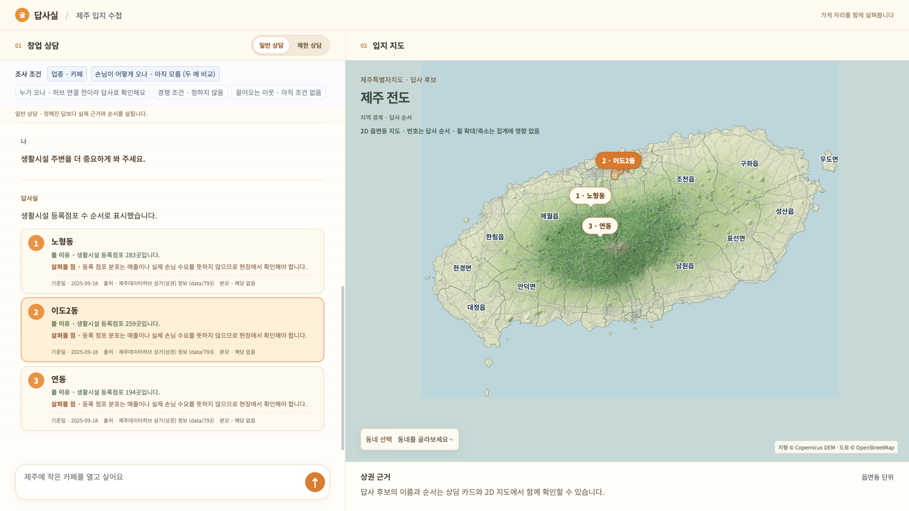

# 상권하르방

**넓은 제주에서 내 가게에 맞는 상권을 대신 조사하는 AI 에이전트**

[웹에서 상담 시작](https://jeju-ai-agent-challenge.vercel.app/) · [노형동 조사 결과 보기](https://jeju-ai-agent-challenge.vercel.app/dong/50110660) · [심사위원 사용 가이드](docs/심사위원_사용가이드.md)

> “제주에 작은 카페를 열고 싶어요. 아직 동네는 정하지 않았어요.”

상권하르방은 제주에서 가게를 열려는 40~60대 개인 창업자를 위한 점포개발 담당자입니다. 상담 도우미 **귤이**가 지역과 손님에 관해 하나씩 묻습니다. 창업자가 답하면 같은 기준으로 동네를 비교해 **후보 지역, 선정 근거, 현장에서 확인할 점**을 보여 줍니다.



## 상담에서 답사까지

- 한 문장으로 시작합니다. 상담 도우미 귤이가 조건을 하나씩 확인합니다. 예: "제주에 작은 카페를 열고 싶어요"
- 한 번에 선택지 하나를 확인합니다. 지역을 아직 정하지 않아도 실제 등록 점포 자료의 비교 기준으로 후보를 좁힐 수 있습니다.
- 후보 동네 1~3곳을 후보 카드와 2D 지도에 같은 순번으로 표시합니다. 카드나 핀을 고르면 같은 동네가 양쪽에서 강조됩니다. 카드에는 기준일·출처·분모·주의점이 있습니다.
- 지도에서 동네를 고르면 3D로 들어가 실제 점포 위치를 보고, 점포를 눌러 "여기 왜 표시됐어요?"처럼 물을 수 있습니다.
- 표선면에서는 실제 버스 정류장에서 가정한 목적지까지 걷는 경로가 고른 가게 옆을 지나는지 미리 봅니다(가정 보행, 관측 유동 아님).

임대 매물이나 매출을 알려 주는 서비스가 아닙니다. 지도 위 점은 실제 상가 정보의 위치이고, 추천은 답사 순서를 정하는 데 씁니다.

## 실행

심사 체험: [상권하르방](https://jeju-ai-agent-challenge.vercel.app/). 설치 없이 브라우저에서 엽니다.

공개 저장소는 소스와 가이드 중심으로 구성되어 있습니다. 아래 로컬 실행 절차에는 제출 패키지의 가공 지도·점포 자료(`web/data/`)가 필요합니다. 별도 자료 없이 체험하려면 위 웹 상담을 이용하세요.

Docker 실행에는 Docker Desktop 또는 Docker Engine과 Compose v2.24 이상이 필요합니다. 자료가 준비된 소스 폴더에서 실행합니다.

```bash
docker compose up --build -d
# 브라우저에서 http://127.0.0.1:8765/ 열기
docker compose down
```

`.env`는 선택 사항입니다. 온라인 지도는 등록된 주소와 `KAKAO_MAP_JS_KEY`를 사용합니다. 키나 인터넷이 없으면 로컬 2D 지도로 표시합니다. 키를 이미지에 넣지 않습니다.

### 기존 Windows 번들

1. `jeju-agent-submission.zip` 을 풀고 `jeju-agent` 폴더의 **실행.bat** 을 두 번 누릅니다.
2. 잠시 뒤 브라우저가 `http://127.0.0.1:8765/` 를 엽니다. 안 열리면 Chrome/Edge 주소창에 그대로 적습니다.
3. 끄려면 검은 창을 닫습니다.

파이썬과 Windows용 라이브러리는 ZIP 안에 들어 있어 따로 설치하지 않습니다. 인터넷이 없어도 지도·후보·점포·가정 보행 미리보기는 동작합니다. 선택적 자유 대화와 실시간 허브 조회는 키와 인터넷이 필요합니다. 자세한 순서는 [docs/설치매뉴얼.md](docs/설치매뉴얼.md)에 있습니다.

## 개발 환경 (macOS/Linux, Python 3.10 이상)

```bash
python3 -m pip install -r requirements.txt
python3 -m app                 # http://127.0.0.1:8765/
python3 -m app --no-llm        # 모델 없이 상담 순서와 버튼으로만
python3 -m app --offline       # 모델·허브 API 모두 끔 (바깥 호출 없음)
python3 -W ignore -m unittest discover -s tests -t .
```

자료를 처음부터 다시 만들려면 `build/fetch_data.py` → `build/build_data.py` → `build/build_terrain.py` → `build/build_buildings.py` → `build/build_walk.py` 순서로 실행합니다(필요 패키지는 각 파일 첫머리를 참고). 허브 파일·행정동 경계·DEM은 `fetch_data.py --check`가 sha256으로 대조합니다. OSM 도로(`data/raw/ext/osm_roads_jeju.json`, osm base 2026-07-24)와 표선 보행 자료(`data/raw/ext/osm_pyoseon_walk.json`, osm base 2026-11-19)는 Overpass API 시점 자료라 `fetch_data.py`가 다시 받지 않습니다. 개발 PC 원본의 sha256은 도로 `b4ee24d71e2f565218a874123f20f3429b9be56646d143d9c7662814940922c4`, 표선 보행 `d8c5f827211beaaf4f0c7445956a7ac275ff227d0d350efe007ccc8c8664c925`입니다. 당시 Overpass 질의 원문이 없어 다시 받으면 결과가 달라질 수 있습니다. 제출한 `web/data`는 위 원본으로 만든 것입니다.

아래 빌드 명령은 저장소 checkout에서 실행합니다. 기존 `dist/`를 건드리지 않도록 별도 출력 폴더를 지정합니다. 온라인 빌드는 공식 Python embeddable ZIP과 고정된 최상위 요구사항의 Windows 휠을 받아 압축합니다. 생성된 `jeju-agent/wheels/`와 Python ZIP을 보관하면 같은 휠 집합으로 오프라인 재빌드할 수 있습니다.

```bash
python3 build/package_windows.py --output-dir /tmp/jeju-agent-release-01
# 이전 산출물의 Python ZIP과 wheelhouse만 사용하는 네트워크 차단 재빌드
python3 build/package_windows.py --output-dir /tmp/jeju-agent-release-02 --offline \
  --python-archive /path/python-3.12.10-embed-amd64.zip \
  --wheelhouse /path/to/jeju-agent/wheels
```

Python 3.10 이상과 pip가 있는 빌드 PC가 필요합니다. 첫 온라인 빌드는 python.org와 패키지 인덱스에 접속해 공식 런타임과 Windows 휠을 받습니다. 출력 폴더에는 `jeju-agent/`, `jeju-agent-submission.zip`, 온라인 빌드 입력을 보관하는 별도 `cache/`가 만들어집니다(`cache/`는 ZIP에 들어가지 않습니다). `jeju-agent/wheels/`에는 배포 휠 원본이 들어 있습니다. 이미 `jeju-agent/` 또는 ZIP 경로가 있거나 출력 위치가 `dist/` 아래면 빌더는 중단하며 덮어쓰거나 지우지 않습니다. 포함 파일은 명시적 allowlist로 제한되고 휠·Python ZIP의 SHA-256, 배포 자료 기준일·지문은 `docs/포함된_라이브러리.txt`에 기록됩니다.

## 데스크톱 E2E 및 Windows 실기기 게이트

저장소 checkout에서 실행하는 오프라인 브라우저 E2E는 Python 3.10 이상, 설치된 Chrome/Edge, Playwright Python 패키지가 필요합니다. 아래 명령은 실제 `/` 상담 UI에서 문장 입력 → 화면에 나온 `아직 모름` 선택 → 실제 선호 칩 선택 → 카드/핀 순번 대조와 양방향 강조를 수행합니다. 로컬 서버는 `offline=True`이고 외부 브라우저 요청은 차단·실패 처리됩니다. 이 개발 도구는 제출 ZIP에 넣지 않습니다.

```bash
python3 -m pip install playwright
python3 tools/notebook_shot.py --browser chrome --out shots/release-chrome
python3 tools/notebook_shot.py --browser msedge --out shots/release-edge
```

Playwright의 브라우저 다운로드가 아니라 PC에 설치된 Chrome 또는 Edge가 필요합니다. `report.json`은 실행 브라우저·1920×1080/100% 뷰포트·웹 자료 지문·선택 결과를 남깁니다. 이 테스트는 소스 코드에서 동작하는 브라우저 시나리오만 확인합니다. ZIP의 Windows 실행이나 더블클릭은 검증하지 않으며, 두 브라우저 시나리오가 통과해도 clean Windows 게이트를 통과한 것이 아닙니다.

기존 Windows 번들을 배포할 경우에만 [설치·실행 매뉴얼](docs/설치매뉴얼.md)의 Windows 실기동 절차로 검증합니다. Docker나 소스 E2E는 해당 번들의 실기동 증거가 아닙니다.

## 구성

| 경로 | 역할 |
|---|---|
| `app/engine.py` | 조건 판정과 후보 계산, 후보 카드 숫자(모두 원자료에서 직접 셈) |
| `app/advisor.py` | 생활 장면 질문 하나와 답별 비교 기준, 후보 A/B/C 카드 |
| `app/agent.py` | 선택 가능한 Gemini 경로: 문장을 도구 호출로 바꿈 |
| `app/agent_openai.py` | 기본 OpenAI 경로(`--provider openai`), 키가 없거나 실패하면 로컬 경로 사용 |
| `app/place.py` | 점포·건물 클릭, "여기 왜?" 같은 질문에 답하고 지도에 강조 |
| `app/walk.py` | 표선면 가정 보행 경로(정류장 → 목적지, 가게 옆을 지나는가) |
| `app/server.py` | 표준 라이브러리 웹 서버, `/api/*` |
| `web/` | Three.js 3D 지도와 화면, 가공한 자료(`web/data`) |
| `docs/` | 설치 매뉴얼, 데이터 활용 명세, 프롬프트, 제안서 |

## 자료와 라이선스

자료 출처·라이선스·가공 방법은 [docs/데이터활용명세.md](docs/데이터활용명세.md) 에 있습니다. 행정동 경계는 vuski/admdongkor(CC BY 4.0), 지형은 Copernicus GLO-30, 길·건물은 OpenStreetMap(ODbL), 글꼴은 Noto Sans KR(SIL OFL 1.1)입니다.
