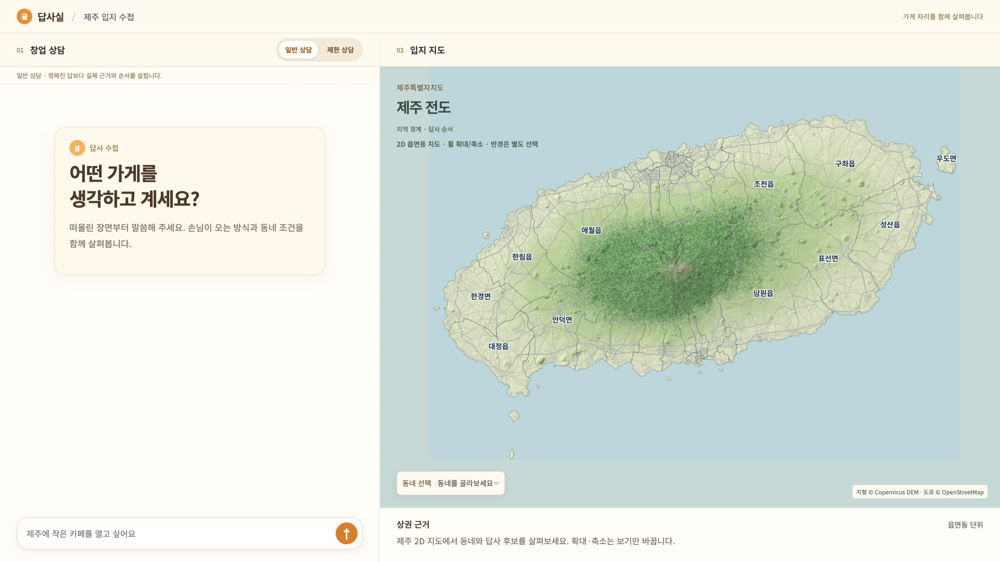
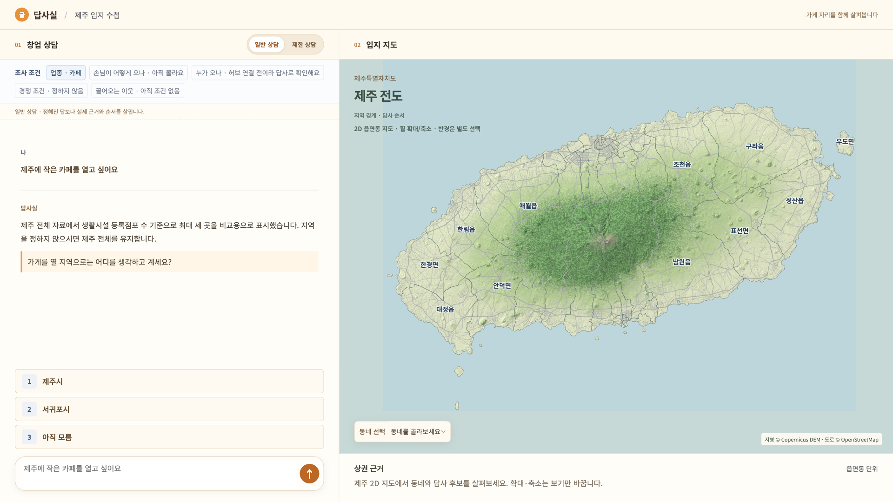
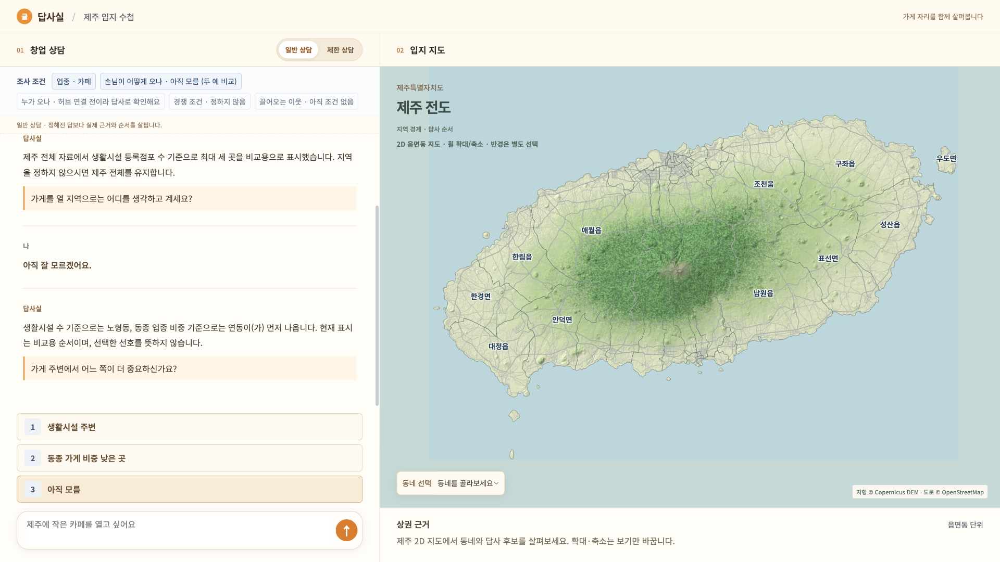
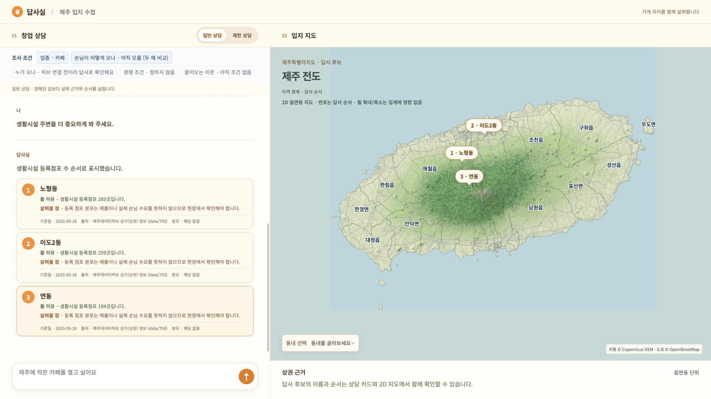
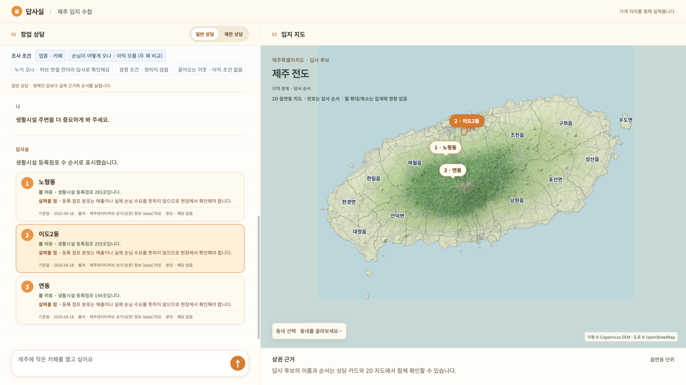
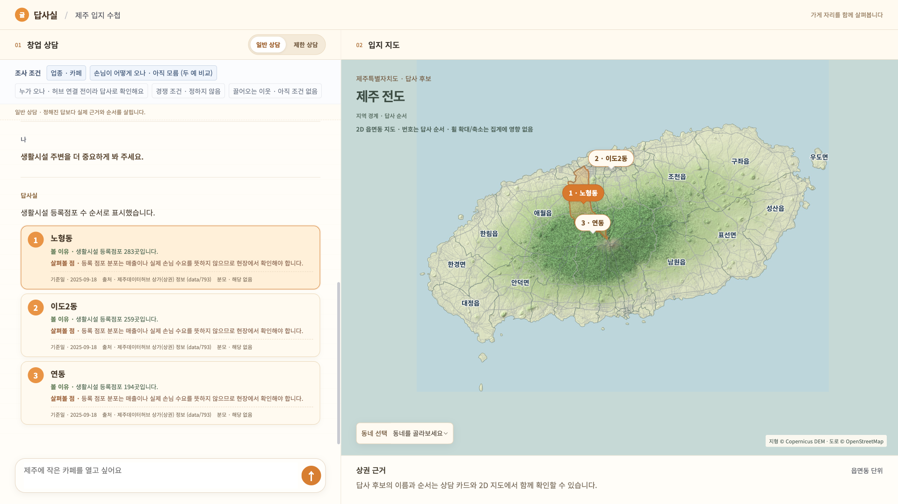

# 상권하르방 | 심사위원 사용 가이드

제주에서 작은 카페를 연다고 생각하고 상담을 시작해 보세요. 먼저 지역 선택을 묻고, 답에 따라 선호 선택지를 차례로 보여 줍니다. 후보 답변 아래 카드와 지도 핀을 함께 살펴봅니다.

## 처음 실행하기

**온라인:** [심사 데모](https://jeju-ai-agent-challenge.vercel.app/)를 Chrome 또는 Edge로 엽니다. 설치나 로그인은 필요 없습니다. 권장 화면은 1920×1080입니다.

**로컬 재현:** Docker Desktop 또는 Docker Engine과 Compose v2.24 이상을 준비합니다. 소스 ZIP을 모두 추출하고 `jeju-agent` 폴더에서 아래 명령을 실행한 다음 `http://127.0.0.1:8765/`를 엽니다. 첫 이미지 빌드에는 인터넷이 필요합니다. 키가 없어도 로컬 2D 지도와 상담은 작동합니다.

```bash
docker compose up --build -d
```

## 한 번의 상담 따라 하기

첫 화면 왼쪽 `창업 상담`에서는 업종, 눈여겨본 동네, 만나고 싶은 손님 중 하나부터 이야기할 수 있습니다. 예시를 따라 입력칸에 `제주에 작은 카페를 열고 싶어요`를 적고 Enter를 누릅니다. 입력한 문장이 `나` 아래에 나타나고, 답변을 준비하는 동안 `자료를 살펴보고 있습니다.`가 보입니다.



1. **지역 선택** — 첫 답변에 표시되는 `제주시`, `서귀포시`, `아직 모름` 가운데 `아직 모름`을 고릅니다. 지역을 정하고 싶으면 두 시 가운데 하나를 고를 수 있습니다.

   

2. **선호 선택** — 지역을 아직 모름으로 두면 다음 차례에 비교 선호 선택지가 새로 나옵니다. 이번 예시에서는 `생활시설 주변`을 고릅니다. 선호 선택지는 첫 질문과 동시에 고정되어 나오지 않습니다.

   

3. **후보 비교** — 답변 바로 아래에 후보 카드 1~3개가 나타납니다. 카드에는 순서, 볼 이유, 살펴볼 점, 기준일·출처·분모가 표시됩니다. 지도에는 각 카드와 같은 순번의 핀 1~3개가 나타납니다.

   

4. **양방향 선택** — 후보 카드를 누르면 같은 순번의 핀이 강조되고, 지도 핀을 누르면 같은 후보 카드가 강조됩니다. 2번 카드를 누른 화면과 1번 핀을 누른 화면에서 서로 확인할 수 있습니다.

   

   

휠 확대·축소는 지도에서 보이는 범위만 바꾸며 추천 순서·카드 근거·집계 결과는 바꾸지 않습니다. 확대 단계에 따라 화면 밖 핀은 보이지 않을 수 있습니다.

등록 점포 수와 분포는 매출, 빈 점포 수 또는 실제 손님 수요를 뜻하지 않습니다. 유동인구를 볼 때는 집계 지역과 관측일을 함께 확인합니다. 읍면동 방문 인구는 특정 가게 앞을 걸어간 사람 수가 아닙니다.

## 별도 선택 기능: 3D 거리

첫 상담과 후보 비교는 2D 읍면동 지도에서 진행합니다. 동네를 선택한 뒤 `3D 거리`가 표시되면 눌러 별도 답사 화면을 열 수 있습니다. `2D 지도`를 누르면 후보 지도 화면으로 돌아옵니다. 3D 보기는 첫 상담에 필수 단계가 아닙니다.

## 실행이 막혔을 때

- **`상담 공간을 확인하지 못했습니다`가 나옵니다.** 점포가 없다는 뜻이 아니라 상담을 시작하지 못했다는 뜻입니다. `초기화 재시도`를 누릅니다. 같은 안내가 반복되면 정상 상담 결과로 보지 않습니다.
- **로컬 주소에 연결할 수 없습니다.** `docker compose ps`로 컨테이너가 실행 중인지 확인합니다. [설치·실행 매뉴얼](설치매뉴얼.md)을 참고합니다.
- **자료나 선택지가 표시되지 않습니다.** 화면에 표시되는 질문과 선택지로 상담을 이어갑니다. 자료가 표시되지 않은 것은 관측값이 0이라는 뜻이 아닙니다.
- **로컬 종료:** 실행한 폴더에서 `docker compose down`을 실행합니다.

자료의 출처와 집계 범위는 [데이터 활용 명세](데이터활용명세.md)에서 확인할 수 있습니다.
